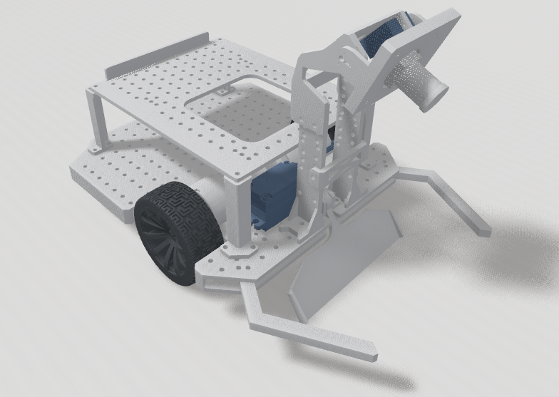

# 小车1127

## 下载与打开

下载整个 `tools/car_model` 目录，保留 `SolidWorks` 内的目录和文件名。用 **SolidWorks 2025** 打开 [小车1127.SLDASM](SolidWorks/小车1127.SLDASM)。该总装采用 **19 齿对称夹爪**及 M 主动、S 从动零件。舵机子装配、零件和导入用 STEP 随包提供。整组文件可以一起移动到任意目录。

[俯视参考图](俯视图.png)

## 结构

| 部位 | 结构与作用 |
| --- | --- |
| 底盘与电子层 | 下层孔板承载驱动、夹爪和相机支架。四个立柱支撑上层孔板，包内还带香橙派底座、扩展板和电源模块模型。 |
| 行走 | 左右两台 MG513P30 直流减速电机分别驱动车轮，通过左右转速差转向。后部万向轮提供第三个支撑点。 |
| 前导铲 | 安装在车头中间，工作时导引地面物块，并形成夹爪中间的后方边界。 |
| 夹爪 | 一台舵机驱动 M 爪，S 爪由 1∶1 齿轮带动反转。M 的大凹槽套舵盘，S 的小凹槽朝底盘。维修或打印时每款使用一件 M 和一件 S。 |
| 相机 | 双侧立式支架支撑摄像头平台，俯仰轴由独立舵机驱动。 |

## 关键尺寸

尺寸单位为 mm。整车外形按主装配体的空载闭合姿态和所显示零件计算，读数取约值。以底盘后缘为纵向零点，朝向夹爪为车头。

| 项目 | 尺寸 | 读数口径 |
| --- | ---: | --- |
| 整车长 × 宽 × 高 | **288.3 × 192.0 × 180.9** | 从底盘尾端到夹爪最前端，宽度取左右轮胎外侧，高度从支承平面到相机支架最高点。 |
| 下层底盘长 × 宽 | **200 × 190** | 底盘本体外轮廓。 |
| 上层孔板长 × 宽 | **160 × 130** | 上层板的平面包络。 |
| 左右驱动轮中心距 | **166.0** | 两个轮胎轴向中面之间的距离。 |
| 驱动轮轴线到车尾 | **130** | 从底盘后缘到驱动轮的共同轴线。 |
| 驱动轮轴线到后万向轮中心 | **95** | 沿车身纵向量取。 |
| 驱动轮 | **名义 Ø65** | CAD 胎纹外径约 66.3，单轮总宽约 26.0。 |
| 前导铲宽 | **110** | 铲板左右外缘。 |
| 夹爪转轴中心距 | **27.65** | 两根竖直夹爪轴之间，爪板厚 6。 |
| 主从齿轮 | **19 齿，模数 1.45** | 1∶1 反向联动，参考压力角 20°。 |
| M / S 凹槽 | **Ø20.5 / Ø10** | 都深 2，分别朝舵盘和底盘。 |
| 夹爪工作开角与净宽 | **单侧 28°，净宽 109.5** | 入口向里 25 mm 内的最窄宽度。 |
| 夹爪工作行程内最大车长 | **288.73** | 设计扫掠 0°–28° 的结果，设计上限为 290。 |

## 打包核验

2026-11-27 将整个模型目录复制到新的路径，在原打包路径不可用时用 SolidWorks 2025 重新打开。包内 4 个装配体、25 个零件和 2 个 STEP 文件均已随目录交付。整车的 46 个组件实例可以解析，包外依赖为 0，重建后配合无报错。首次打开如显示需要重建，在 SolidWorks 里执行重建即可。

打包版默认显示上层孔板，并隐藏位于装配原点附近、没有装到车上的备用舵机。相机与前导铲按保存姿态展示。
