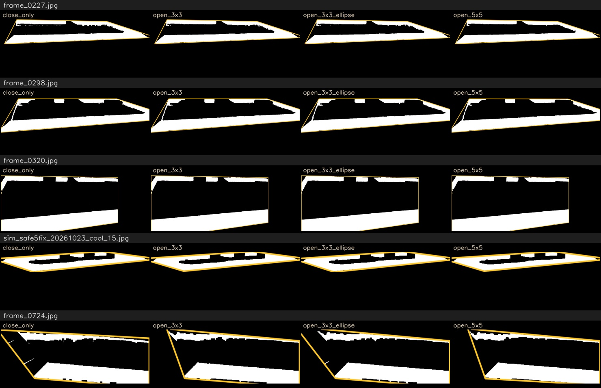
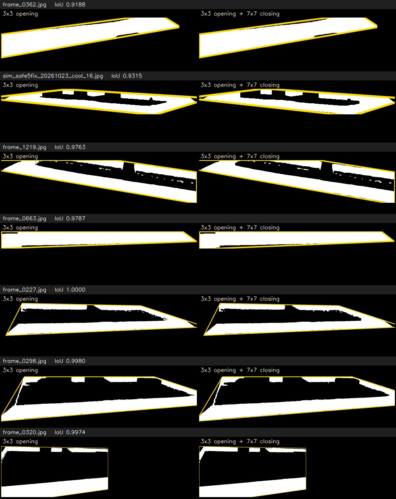
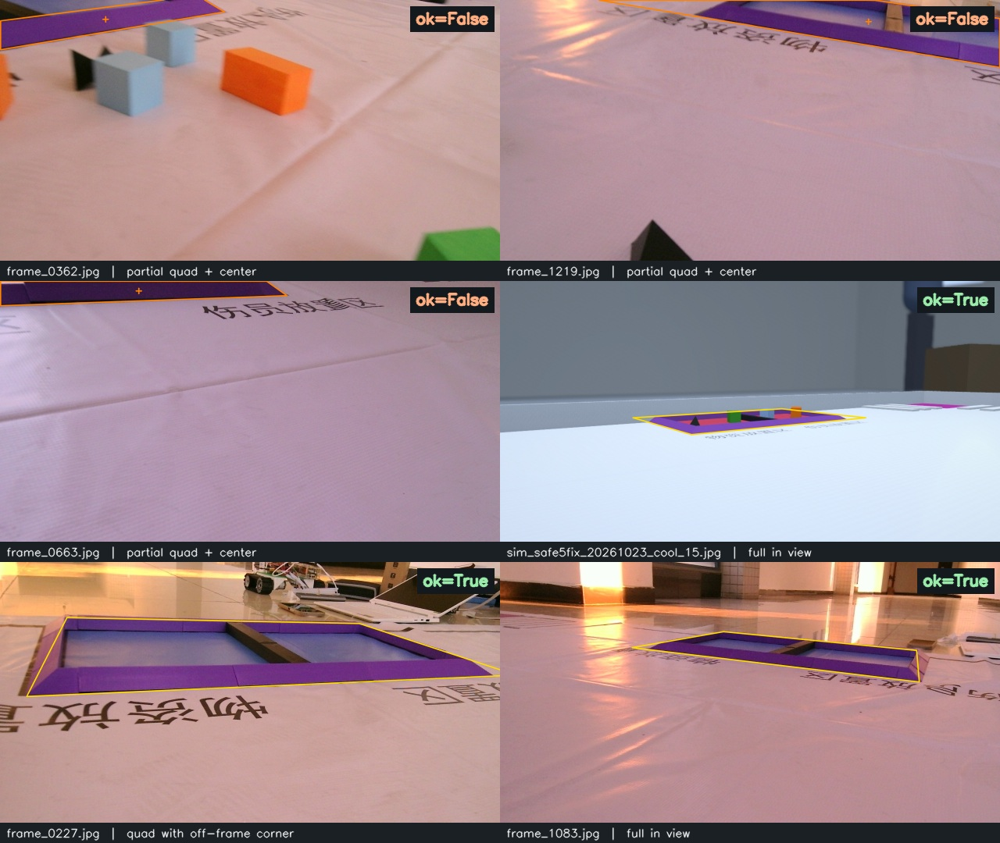

初版的凸包检测，依赖YOLO预选框

双击同目录的 `启动安全区识别.cmd`。样图在上一级 `assets/first`，沿用原 ONNX 模型。

## 外框算法迭代

YOLO 预选 → 3×3 高斯模糊 → 单组 HSV 掩膜 → 3×3 开运算 → `findContours` → 凸包 → `approxPolyN` 外接四边形。

- **从霍夫直线换成凸包。** 霍夫检测后还要合并断线和重线。凸包可以跨过暖光造成的断口。
- **用 `findContours` 提点。** 与 `findNonZero` 得到的凸包相同。48 张图的点数中位数从 58,586 降到 882，取点到拟合从 13.44 降到 0.37 ms/ROI（OpenCV 单线程）。
- **3×3 开运算。** 小于 20 像素的白块从 180 个降到 41 个。5×5 会削掉一些细栏杆。

- **去掉闭运算。** 48 张有无 7×7 闭运算都能拟合出四边形，面积交并比中位数 99.91%，最低 91.88%。

- **四边形和完整性。** 48 张复测有 37 张局部可见、11 张判为看全。当掩膜贴原图最外 3 像素时不判为看全。拟合坐标可以延伸到画面外。

