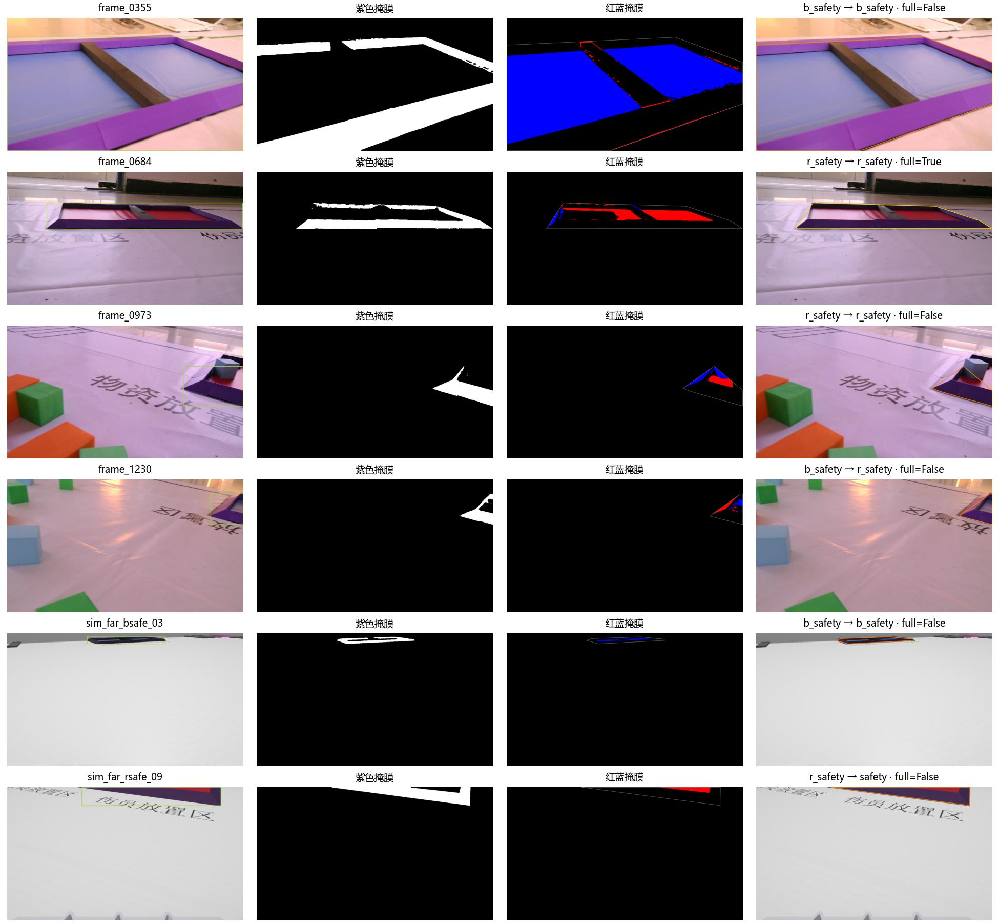

# v2 · 整图 OpenCV


## 流程

1. 在原图做一次紫色掩膜和 5×5 闭运算。找出最大紫块，把它和附近够大的紫块一起圈住。绿框就是这个范围，凸包也用这批紫块来算。
2. 填满多边形，用 `cv2.countNonZero` 数红、蓝、紫像素。占比都除以整个多边形的像素数。红蓝计数时排除紫色。
3. 红、蓝各自过 12% 门槛，过线后像素多的那一色胜出。

## 调用

```python
detector = SafetyDetector()
safety = detector.detect(frame)
```

`safety.flag` 是 `safety`、`r_safety` 或 `b_safety`。用 `safety.status['detected']` 区分是否找到了安全区。

## status

- `detected`　找到了安全区多边形。
- `full`　轮廓未被截断，内部可见。
- `ok`　当前帧 `full=True`，并且已经判出红蓝属性。

图上的角标显示 `full`。后续投放代码在找到目标后，`full=False` 时后退。看全后，可先用同一目标连续 3 帧 `ok=True` 作视觉确认。

## 效果

72 张图里，57 张判对，14 张保留为 `safety`，1 张判反（`full=False`）。去掉缩图时做的对照测试，识别总耗时中位数分别为 2.81 和 4.46 ms，P95 分别为 7.51 和 7.05 ms（Windows 笔记本）。


