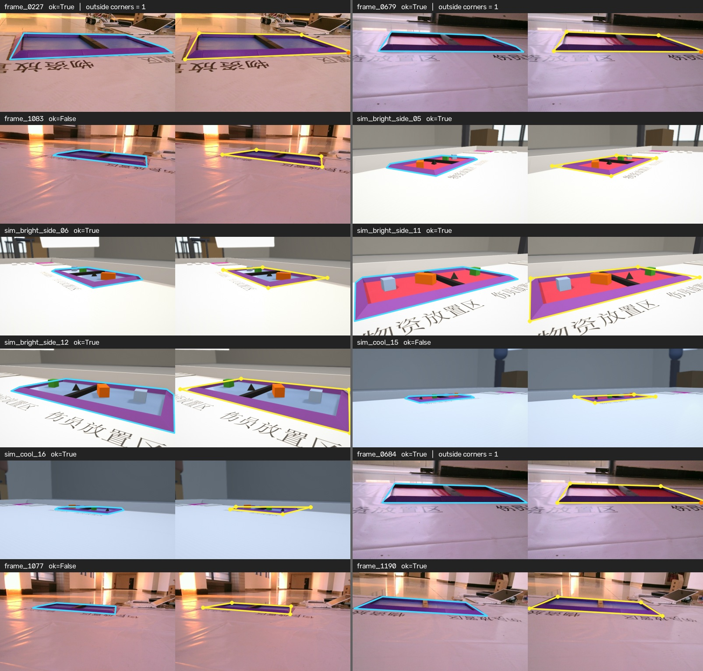
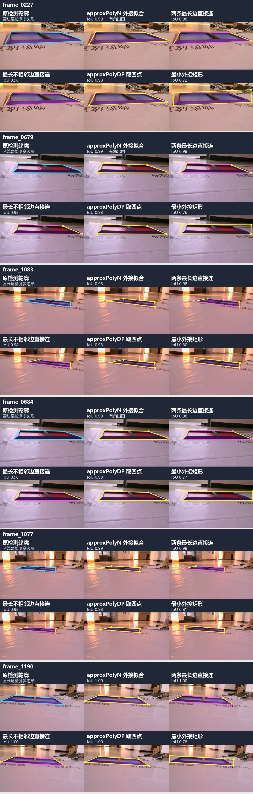
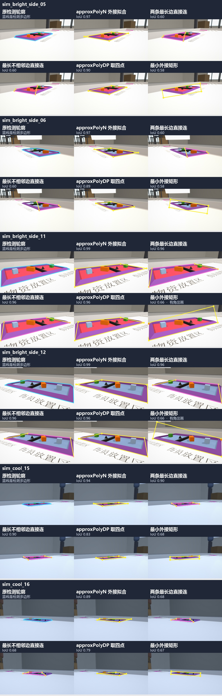
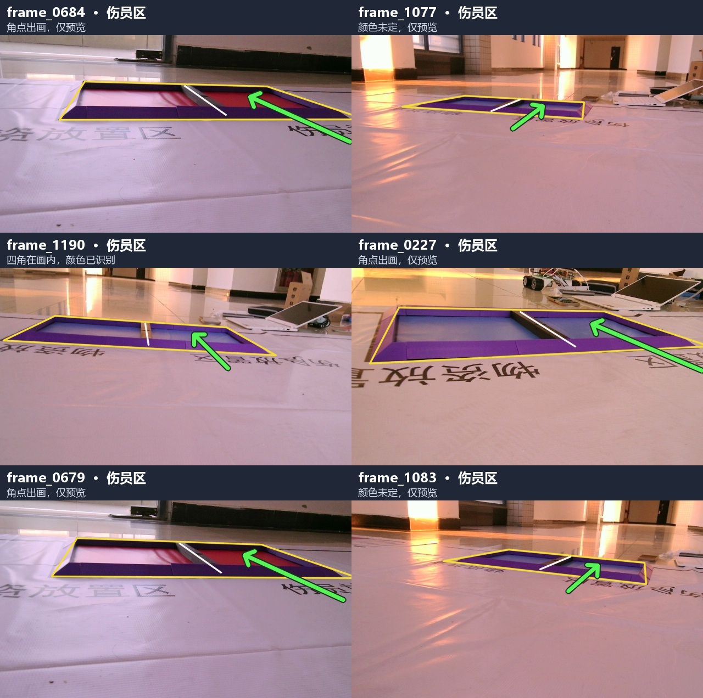
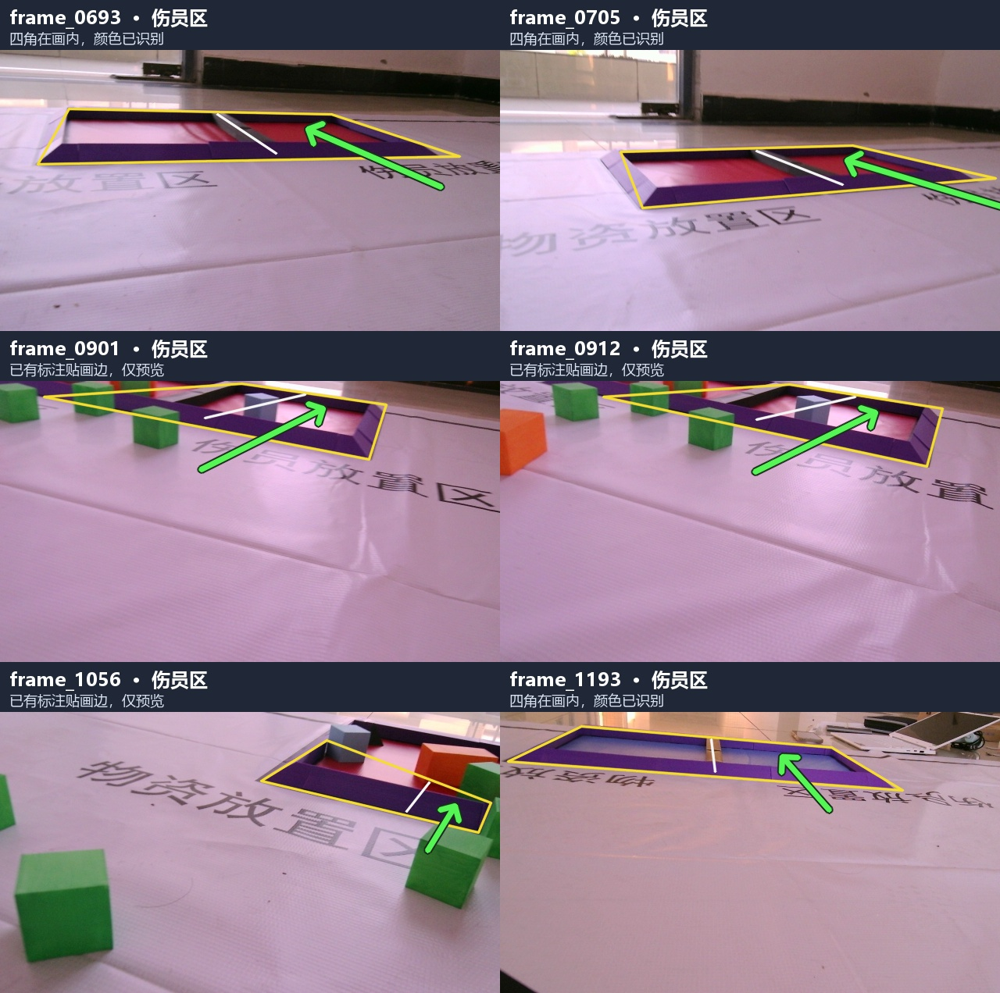
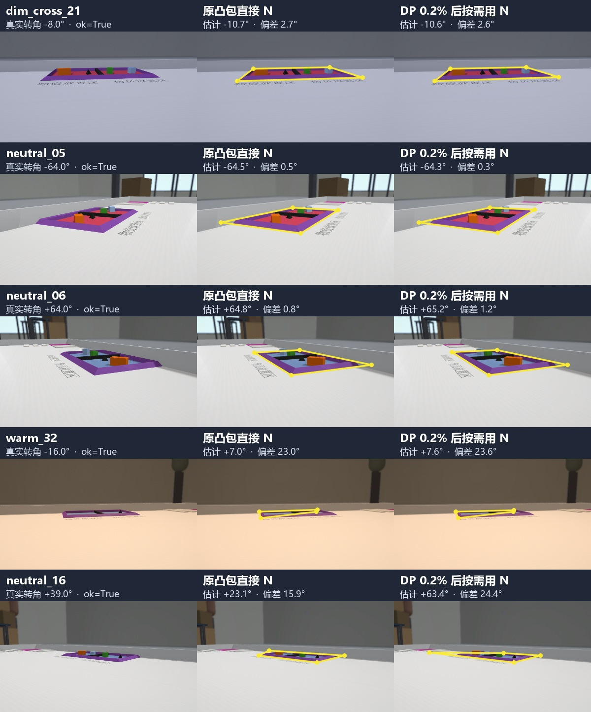
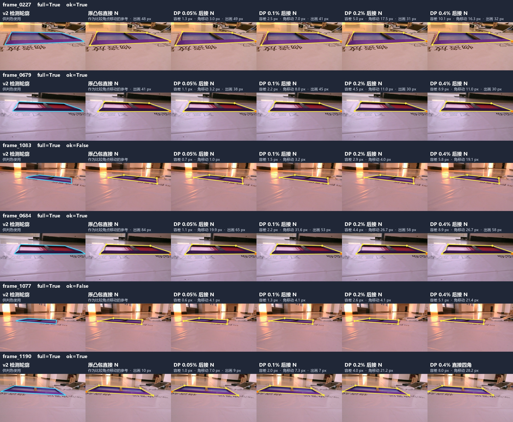
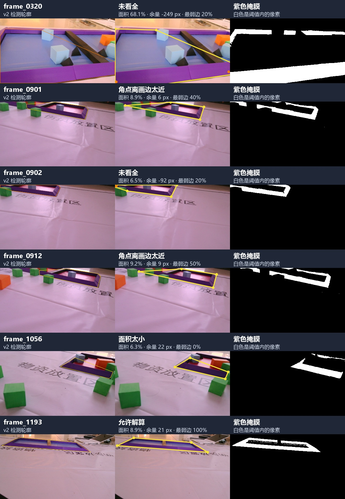
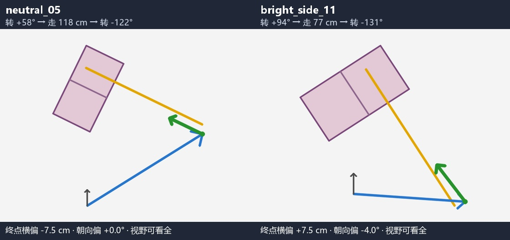

## 第一个实验:安全区四边形粗拟合

2026-11-21

沿用 v2 检测，筛选 `full=True` 的图片。用 `approxPolyN` 把检测多边形近似成四边形。每组左蓝是检测多边形，右黄是拟合四边形。橙点标出出画角的位置。

现有 72 张样图里有 12 张判为 `full=True`，均画出四边形。其中 3 张为 `ok=False`，也纳入比较。3 张拟合后各有一个角超出画面。

从仓库根目录运行。

```powershell
python -m tools.experiments.detect_safety.v3.fit_quad
```



### 同一批样图比较五种拟合

取两条最长边的四个端点，沿着凸包顺序连起来。另一种只在不共端点的边对里选总长度最大的一对。其余三种用 `approxPolyN`、逐步放宽容差直到取到四点的 `approxPolyDP`、最小外接矩形。

| 方法 | 拟合张数 | 有角点出画 | IoU 中位数 | 最低 IoU |
| --- | ---: | ---: | ---: | ---: |
| `approxPolyN` | 12 | 3 | 0.987 | 0.887 |
| 两条最长边 | 12 | 0 | 0.966 | 0.598 |
| 最长的两条不相邻边 | 12 | 0 | 0.966 | 0.598 |
| `approxPolyDP` | 12 | 0 | 0.966 | 0.789 |
| `minAreaRect` | 12 | 2 | 0.700 | 0.576 |

IoU 是拟合四边形和检测多边形的面积交并比。IoU 越高，两个轮廓重叠越多。样图里没有标真实角点，目前只用它比较贴合程度。

这 12 张里，两种最长边选法都挑到了同一对边。实拍几张简单视角贴得较好，仿真左右斜视的 `bright_side_05`、`bright_side_06` 切掉了一块，IoU 约 0.60。下一步可用 `approxPolyN` 和 `approxPolyDP` 各算一次，比较车头朝向的误差。

每张小图上方都写了方法名。同一个文件名下面是两行对照图。粉线是选中的两条边，橙点表示角在画外。





```powershell
python -m tools.experiments.detect_safety.v3.compare_quad
```


## 第二个实验:验证解算得到需要的最终朝向

### 实拍上画对准后的直行箭头

DP 容差设为周长 × 0.002，再按需做 N。用四边形把右半格的中心线投回图像，绿箭头就是小车对准伤员区后直行的方向，白线是分隔线。箭头长度用于显示。相机视角按从场地内看安全区正面处理。

使用原有 6 张 `full=True` 实拍和训练目录中另选的 6 张实拍。拟合角出画、颜色未认出或已有标注贴画边的样图标为仅预览。已有标注只作离线提示。





```powershell
python -m tools.experiments.detect_safety.v3.show_real_heading --images D:/my_project/deeplearning/yolov8_simple_use/datasets/gongchuang_train/images
```

### 仿真转角复核

使用现有的 200 张 Godot 渲染图。用批次记录的角度当真值，用 70° 水平视场角和每帧记录的相机俯角解算。84 张判为 `full=True`，其中 81 张为 `ok=True`。

同一个 660 × 360 mm 外框模型、同一套平面 PnP。分别对原凸包直接做 N，以及用周长的 0.2% 做 DP 后再按需做 N。正数为右转。物资和伤员的对准位置不同，最终车头都垂直于安全区前长边。

| 方法 | 解算张数 | 平均转角误差 | 中位误差 | 最大误差 | 误差大于 10° |
| --- | ---: | ---: | ---: | ---: | ---: |
| 原凸包直接 N | 84 | 5.64° | 4.19° | 22.98° | 11 张 |
| DP 0.2% 后按需用 N | 84 | 4.99° | 4.06° | 24.43° | 6 张 |

小容差 DP 的 84 张结果仍然超过 4 个点，这批都进入了 N。平均误差小一些，最差的一帧仍偏了 24.43°。`warm_32` 只识别到部分围栏，却被判为 `full=True`，两种估计都把左转算成了右转。这里验证的是静态朝向，镜头参数使用渲染设置。

```powershell
python -m tools.experiments.detect_safety.v3.compare_heading D:/my_project/gongchuang_sim/reports/safe_light_20261023_fixed
```



### 用已有实拍图核对 epsilon

48 张实拍中有 6 张判为 `full=True`。对同一份检测凸包只换 DP 容差，再按需做 N。角点移动量以直接 N 为参考，画出的角没有人工真值。

| DP 容差占周长 | 每张最远角点移动量的中位数 | 有角点出画 |
| --- | ---: | ---: |
| 直接 N | 参考 | 4 / 6 |
| 0.05% | 3.6 px | 4 / 6 |
| 0.1% | 7.1 px | 4 / 6 |
| 0.2% | 14.3 px | 3 / 6 |
| 0.4% | 20.2 px | 3 / 6 |

`frame_0684` 在 0.1% 时有一个角移动了约 32 px，五种结果仍有角出画。0.2% 让 `frame_1190` 的四角回到画内。实拍样图缺少真实转角。

```powershell
python -m tools.experiments.detect_safety.v3.compare_real_epsilon
```



## 第三个实验：确定动作

### 静态检查

保留 v2 的 `full` 和判色。当前帧要用于解算，再检查四边形是否凸、面积是否足够、角点离画边是否有余量，以及四条边是否有紫色像素支持。实验先试画面面积 8%、720p 下角点余量 10.8 像素、每条边至少 60% 有支持。阈值用于本次离线试验。

- `frame_0320` 的前围栏贴画边。后围栏有若干紫色断段，右后段面积约 1.93 万像素，小于最大前段面积的 12%，v2 合并时丢掉了它，凸包连出对角线。
- `frame_0901` 和 `frame_0912` 面积分别是 8.9% 和 9.2%，角点距画边仅 6、9 像素。面积单独筛选会通过。
- `frame_0902` 原检测为 `full=False`。`frame_1056` 面积只有 6.3%，并有一条边完全没有紫色像素支持。`frame_1193` 通过这次静态检查。



### 理想运动回放

停车解算右格前方的轴心停车点，然后给出「转角、直行厘米数、末次转角」。理想差速车按整数指令走一遍，用原 Godot 批次位姿核对终点。图中蓝箭头是到停车点的直线，绿箭头是最后车头朝向，黄线是伤员区真实中心线。

放宽面积到 5% 取 41 组做回放。65 cm 目标轴心距离下，平均横偏 4.84 cm、平均朝向误差 3.68°，终点看全真实四角 6/41。85 cm 时为 5.41 cm、3.68°、31/41。65 和 85 cm 是本次对照参数。看全只用终点相机投影检查，未使用新的 Godot 渲染帧，暂未验证轮滑、障碍和实际复识别。



动态确认放在动作结束后。停车取新图，重新检查本方安全区和剩余横偏、朝向误差。都小再直进。误差大就基于新帧重算。看不全先退到看全，目标丢了先找回再算。

```powershell
python -m tools.experiments.detect_safety.v3.approach_trial D:/my_project/gongchuang_sim --min-area .05 --standoff .85 --path-image --real-images D:/my_project/deeplearning/yolov8_simple_use/datasets/gongchuang_train/images
```
